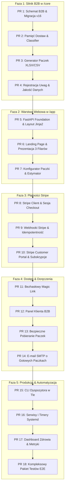

# GUNB B2B Lead Tool — Plan Projektu i Wizja Architektoniczna

## 1. Wizja Produktu
**GUNB B2B Lead Tool** to wyspecjalizowany system wywiadu gospodarczego dla handlowców, dystrybutorów materiałów budowlanych oraz wykonawców (B2B). Narzędzie monitoruje oficjalny Rejestr Wniosków, Decyzji i Zgłoszeń (RWDZ) Głównego Urzędu Nadzoru Budowlanego (GUNB), przekształcając surowe, chaotyczne wpisy urzędowe w wyselekcjonowane, precyzyjnie dopasowane szanse sprzedażowe (leady).

### Model Biznesowy: Hybryda
- **Jednorazowa Paczka (One-off):** Handlowiec kupuje spójną, historyczną paczkę inwestycji dla wybranego rejonu (np. województwo, powiat, promień km) i branży (np. HVAC, stolarka, stan surowy, elewacje).
- **Abonament (Subscription):** Subskrybent otrzymuje cykliczne dostawy świeżych danych (nowe decyzje i zgłoszenia) oraz aktualizacje statusów projektów w toku, zintegrowane przez Stripe Billing i Customer Portal.

---

## 2. Trzy Filary Wartości (Główne Przewagi)

### Filar 1: Ścisłe Dopasowanie (Strict Fit & Explanations)
Handlowiec nie może tracić czasu na przeglądanie setek nieistotnych zgłoszeń (np. wymiana pieca, montaż klimatyzatora w lokalu, zgłoszenie ogrodzenia).
- **Twarde wykluczenia (Hard exclusions):** Precyzyjne odrzucanie zamierzeń niebędących nową budową kubaturową lub gruntowną rozbudową (np. rozbiórki, sieci elektroenergetyczne, instalacje gazowe, tablice reklamowe, mała architektura).
- **Ocena dopasowania i uzasadnienie (Rationale):** Każdy lead posiada czytelną klasyfikację (np. `domki`, `duże obiekty komercyjne`, `inwestycje publiczne`), ocenę punktową (`scoring`) oraz jawne wyjaśnienie: *dlaczego projekt jest wartościowy* i *kiedy zadzwonić* (timing budowlany na podstawie etapów RWDZ: decyzja, pozwolenie, zawiadomienie o rozpoczęciu robót).

### Filar 2: Pamięć Dostaw (Delivery Memory)
Kupujący paczkę lub subskrybent **nigdy nie płaci dwa razy za tę samą informację** ani nie dostaje znanego projektu jako "nowość".
- **Nowe:** Inwestycje, które pojawiły się po raz pierwszy od daty granicznej klienta.
- **Zmiany:** Znane już klientowi inwestycje, w których nastąpiła kluczowa zmiana etapu (np. wydanie decyzji po wniosku, zgłoszenie kierownika budowy).
- **Pełna baza (Snapshot):** Całościowe archiwum rejonu z zachowaniem historii zmian.
- **Idempotentność wydań:** Stan dostaw per konto/zamówienie jest trwale audytowany w bazie SQLite.

### Filar 3: Jawna Jakość Danych (Explicit Data Quality)
Brak mydlenia oczu – system nie ukrywa luk w danych urzędowych, lecz jawnie je dokumentuje.
- **Pochodzenie danych (Provenance):** Oznaczenie organu wydającego (np. Starostwo Powiatowe, Prezydent Miasta, Wojewoda, GUNB centrala).
- **Weryfikacja lokalizacyjna (Geocoding ULDK):** Precyzja działkowa z Geoportalu/ULDK z linkiem do mapy i geoportalu, a w razie braku numeru działki – fallback do gminy i jawna etykieta `brak współrzędnych działki`.
- **Raportowanie niezgodności:** Możliwość zgłoszenia błędnego wpisu przez handlowca (np. „telefon do projektanta, a nie inwestora”).

---

## 3. Mapa Techniczna i Podział Ról

```
+-------------------------------------------------------------------------+
|                              SYSTEMD TIMERS                             |
|              (Harmonogram zadań w tle / cykliczny scraping)             |
+------------------------------------+------------------------------------+
                                     |
                                     v
+-------------------------------------------------------------------------+
|                         CORE ENGINE (/core)                             |
|  - gunb_scraper: pobieranie paczek ZIP/XML z RWDZ GUNB                 |
|  - data_filter & scoring: twarde wykluczenia, punktacja, segmenty       |
|  - geocoding_uldk: zapytania do ULDK, wyznaczanie centroidu działek     |
|  - stages & ranking: timing budowlany ("Kiedy dzwonić")                |
|  - storage.py: transakcyjny LeadRepository, migracje, blokady leasing   |
|  - maintenance: automatyczne kopie bazy (VACUUM INTO), retencja        |
|  - email_sender: powiadomienia SMTP z TLS (SupervisedSMTP)              |
+------------------------------------+------------------------------------+
                                     |
                                     v  [Krótkie transakcje SQLite WAL]
+-------------------------------------------------------------------------+
|                        BAZA DANYCH (SQLite WAL)                         |
|  - investments, status_history, geocache, zadania, blokady              |
+------------------------------------+------------------------------------+
                                     ^
                                     |  [Tylko odczyt + obsługa zamówień]
+------------------------------------+------------------------------------+
|                         WEB PORTAL (/app)                               |
|  - FastAPI: serwowanie stron i endpointów API                          |
|  - Jinja2: szablony HTML panelu klienta, konfiguratora i pobierania    |
|  - Stripe Integration: Checkout (paczki), Billing (subskrypcje),       |
|    Customer Portal, obsługa webhooków                                   |
|  - Statyczna wizytówka marketingowa / formularz zapytania               |
+-------------------------------------------------------------------------+
```

### Rola `/core` (Silnik Przetwarzania)
- Czyste środowisko Python, bez zależności od frameworków webowych.
- Odpowiada za:
  1. Pobieranie danych z RWDZ (`GunbScraper`).
  2. Standaryzację i sanityzację tekstu (`text.py`, `teryt.py`).
  3. Geokodowanie działek w ULDK (`geocoding_uldk.py`).
  4. Scoring, reguły branżowe i wykluczenia (`scoring.py`, `data_filter.py`).
  5. Trwały zapis w bazie danych (`storage.py`).
- Uruchamiany jako proces CLI (`main.py`) lub przez `systemd timers`.

### Rola `/app` (Aplikacja WWW i API)
- Framework FastAPI z szablonami Jinja2.
- Odpowiada za:
  1. Uwierzytelnianie klientów B2B i bezpieczne linki pobierania.
  2. Konfigurację filtrów klienta (geografia, branża).
  3. Obsługę płatności Stripe (Checkout sessions, webhooki).
  4. Generowanie paczek do pobrania (CSV, XLSX) na podstawie pamięci dostaw.
- **Kluczowa zasada:** `/app` korzysta z `/core` wyłącznie jako biblioteki/modelu danych. Aplikacja webowa nigdy nie blokuje wątków na operacjach importu z RWDZ.

### Rola Bazy Danych (SQLite WAL)
- Plik `gunb_leads.sqlite` w trybie WAL (`Write-Ahead Logging`).
- Krótkie transakcje (`BEGIN IMMEDIATE`), brak długich blokad.
- Bezpieczne współdzielenie między procesem tła (`/core`) a serwerem HTTP (`/app`).

---

## 4. Zasady Niezawodności i Integralności

1. **Idempotentność Importu:**
   - Wielokrotne przetworzenie tej samej paczki GUNB daje identyczny stan w bazie.
   - Nowe rekordy otrzymują `ChangeType.NEW`, modyfikacje `ChangeType.UPDATED` lub `ChangeType.STATUS_CHANGED`.
   - Każda zmiana statusu inwestycji jest trwale archiwizowana w `status_history`.

2. **Atomowość Zapisów i Wydań:**
   - Paczka dostarczana klientowi (nowe/zmiany) generuje atomowy rekord wydania z listą identyfikatorów spraw.
   - Pobrana paczka jest niezmienna (immutable snapshot).

3. **Izolacja Blokad (Leasing):**
   - Import wspiera wyłączne blokady procesowe w tabeli `blokady` (z czasem TTL). CLI `--fetch` i timer systemowy nie wejdą sobie w drogę.

4. **Weryfikacja Kopii Zapasowych:**
   - Przed każdą migracją schematu bazy danych tworzona jest kopia zapasowa w katalogu `data/backups/`.
   - Kopie tworzone są przy pomocy `VACUUM INTO`, co gwarantuje spójność w trybie WAL bez konieczności zatrzymywania czytelników.
   - Testy automatyczne regularnie weryfikują proces odtwarzania bazy z kopii.

---

## 5. Model Realizacji i Podział Ról Agentów (Lead Coordinator & Workhorses)

Wdrożenie projektu opiera się na dwupoziomowej hierarchii agentów AI:

1. **Główny Koordynator (Reasoning Model):**
   - Rola: Zaawansowany model rozumujący (np. o1/o3, Claude Opus/Sonnet, Gemini Pro).
   - Odpowiedzialność: Strategia, dekompozycja wymagań biznesowych na precyzyjne pakiety zadań, nadzór architektoniczny nad granicą `/core` vs `/app`, tworzenie kontraktów i interfejsów, zarządzanie gałęziami git, scalanie kodu (`merge`) i koordynacja review.

2. **Modele Wykonawcze / "Workhorses" (Szybkie i Ekonomiczne):**
   - Rola: Tańsze modele optymalizowane pod koszt i szybkość (np. Claude Haiku, GPT-4o-mini / Luna, Gemini Flash).
   - Tryb pracy: Działają wyłącznie na własnych, dedykowanych gałęziach funkcyjnych Git (`feat/...`, `fix/...`) lub w wyizolowanych worktree.
   - Odpowiedzialność: Implementacja ściśle zdefiniowanych modułów, pisanie testów jednostkowych, tworzenie szablonów Jinja2, mechaniczne refaktoryzacje i weryfikacja lokalnych testów `pytest`. Nie modyfikują bezpośrednio gałęzi `main`.

3. **Niezależny Reviewer (Read-Only):**
   - Rola: Audytor jakości przed scaleniem do `main` (zgodnie z `CODE_REVIEWER_PROMPT.local.md` i `AGENTS.md`), badający diff pod kątem bezpieczeństwa, wydajności transakcji SQLite i komunikacji.

---

## 6. Kluczowe Decyzje Technologiczne (Zatwierdzone)

1. **Płatności i Subskrypcje (Stripe):**
   - Oficjalna biblioteka `stripe>=10.0,<11.0` przypięta w `requirements.txt` / `requirements.lock`.
   - Zapewnia kryptograficzną weryfikację nagłówka `Stripe-Signature` (HMAC SHA-256) oraz bezpieczne zarządzanie sesjami Checkout i Customer Portal.
2. **Format Paczek B2B (XLSX & CSV):**
   - Wielozakładkowy arkusz `.xlsx` generowany przez `openpyxl>=3.1,<4` z trzema zakładkami:
     - **1. Nowe:** inwestycje, które pojawiły się po raz pierwszy od daty zakupu/ostatniej paczki.
     - **2. Zmiany:** znane już inwestycje z kluczową zmianą etapu (np. decyzja po wniosku).
     - **3. Pełna baza:** kompletny zrzut rejonu z zachowaniem historii statusów.
   - Płaski eksport `.csv` (UTF-8 z BOM dla zgodności z polskimi znakami w Excelu) do importu w CRM handlowca.
   - Rygorystyczna ochrona przed *CSV/Formula Injection* (oczyszczanie znaków `=`, `+`, `-`, `@`).
3. **Autentykacja Klienta (Magic Link):**
   - Bezhasłowy dostęp: handlowiec podaje adres e-mail, otrzymuje podpisany token czasowy (HMAC SHA-256) na skrzynkę pocztową.
   - Po kliknięciu w link tworzona jest bezpieczna sesja w ciasteczku `HttpOnly`, `SameSite=Lax`. Brak konieczności zapamiętywania i resetowania haseł.

---

## 7. Szczegółowy Plan Wdrożenia: 18 Sfokusowanych PR-ów (Od Bazy do Gotowego Produktu)

Każdy PR jest atomowy, posiada dedykowaną gałąź, ściśle określony zakres, przypisane role agentów oraz niezależne kryteria odbioru.



---

### Faza 1: Rozbudowa Silnika `/core` – Pamięć Dostaw, Paczki XLSX/CSV i Zgłoszenia Jakości

#### PR 1: Schemat Bazy Danych dla B2B, Zamówień i Pamięci Dostaw (Migracja SQLite v16)
- **Gałąź:** `feat/core-b2b-schema`
- **Role:**
  - *Koordynator (Reasoning):* Projekt schematu relacyjnego i modeli dataclass w `core/models.py`.
  - *Workhorse (np. Haiku/Luna):* Implementacja migracji v16 w `core/storage.py` oraz testów migracji.
  - *Reviewer (Read-Only):* Weryfikacja kopii zapasowej przed migracją, kluczy obcych i indeksów SQLite.
- **Zakres zmian:**
  - Nowe tabele: `b2b_customers` (email, nazwa_firmy, nip, stripe_customer_id, status_subskrypcji), `b2b_orders` (order_id, customer_id, filtry_json, typ_pakietu, status_platnosci), `b2b_deliveries` (delivery_id, order_id, typ_dostawy, doreczono_utc, plik_xlsx, plik_csv), `b2b_delivery_items` (delivery_id, id_sprawy, rewizja, kategoria_dostawy [new, change, full]).
- **Kryteria akceptacji:**
  - Testy w `tests/test_storage.py` i `tests/test_migration.py` potwierdzają bezbłędną migrację istniejącej bazy z v15 do v16 z zachowaniem dotychczasowych leadów.

#### PR 2: Silnik Selekcji i Pamięci Dostaw (`core/delivery_memory.py`)
- **Gałąź:** `feat/core-delivery-memory`
- **Role:**
  - *Koordynator:* Definicja algorytmu kategoryzacji (Filar 2): rozróżnienie *Nowych*, *Zmian* i *Pełnej bazy*.
  - *Workhorse:* Implementacja klasy `DeliveryClassifier` oraz zapytań SQL do wyliczania różnic per zamówienie.
  - *Reviewer:* Weryfikacja wydajności zapytań (unikanie N+1) i krótkich blokad transakcyjnych.
- **Zakres zmian:**
  - Nowy plik `core/delivery_memory.py`.
  - Logika: porównanie inwestycji spełniających filtry z historią w `b2b_delivery_items`. Rekord bez wcześniejszego wpisu -> `NEW`; ze zmienionym statusem/datą -> `CHANGE`; wszystkie pasujące -> `FULL`.
- **Kryteria akceptacji:**
  - Nowe testy w `tests/test_delivery_memory.py` sprawdzające, że ten sam lead nigdy nie jest zwracany jako nowy w kolejnych paczkach dla tego samego klienta.

#### PR 3: Generator Paczek Handlowych XLSX i CSV (`core/export_package.py`)
- **Gałąź:** `feat/core-export-package`
- **Role:**
  - *Koordynator:* Definicja standardu kolumn handlowych (uzasadnienie, timing budowlany "Kiedy dzwonić", organ, lokalizacja, link do Geoportalu/Google Maps).
  - *Workhorse:* Implementacja generatora XLSX (`openpyxl`) z 3 zakładkami (*1. Nowe*, *2. Zmiany*, *3. Pełna baza*) oraz płaskiego CSV.
  - *Reviewer:* Zabezpieczenie przed CSV/Formula Injection (oczyszczanie znaków `=`, `+`, `-`, `@` na początku pól tekstowych).
- **Zakres zmian:**
  - Dodanie `openpyxl` do `requirements.txt` (czyste ASCII) i `requirements.lock`.
  - Nowy moduł `core/export_package.py`.
- **Kryteria akceptacji:**
  - Testy w `tests/test_export_package.py` weryfikujące poprawność binarną pliku `.xlsx`, obecność 3 arkuszy i sanityzację komórek.

#### PR 4: Moduł Rejestracji Uwag i Jakości Danych (`core/issue_tracker.py`)
- **Gałąź:** `feat/core-issue-tracker`
- **Role:**
  - *Koordynator:* Projekt modelu zgłoszeń błędów od handlowców (Filar 3).
  - *Workhorse:* Tabela `issue_reports` i implementacja metod `report_issue(...)` oraz flagowania jakości w `investments`.
  - *Reviewer:* Walidacja wejścia (sanitizacja tekstu opisu, limit długości, ochrona przed spamem).
- **Zakres zmian:**
  - Plik `core/issue_tracker.py`.
  - Obsługa typów uwag: `zly_telefon`, `to_nie_inwestor_tylko_projektant`, `inwestycja_juz_stoi`, `inna_uwaga`.
- **Kryteria akceptacji:**
  - Testy `tests/test_issue_tracker.py` potwierdzają zapis zgłoszenia i odzwierciedlenie w etykiecie leada.

---

### Faza 2: Warstwa Webowa i Interfejs Klienta (`/app`)

#### PR 5: Szkielet Aplikacji FastAPI i Architektura Szablonów Jinja2
- **Gałąź:** `feat/app-fastapi-foundation`
- **Role:**
  - *Koordynator:* Nadzór nad architekturą middleware (CORS, Security Headers, obsługa błędów HTTP).
  - *Workhorse:* Rozbudowa `app/main.py`, konfiguracja Jinja2Templates, layout `app/templates/base.html`, style CSS.
  - *Reviewer:* Audyt nagłówków HTTP (Content-Security-Policy, X-Frame-Options, HSTS).
- **Zakres zmian:**
  - Dodanie `fastapi`, `jinja2`, `uvicorn` do `requirements.txt` i `requirements.lock`.
  - Szablony: `base.html`, `components/navbar.html`, `static/style.css`.
- **Kryteria akceptacji:**
  - Testy w `tests/test_app_foundation.py` sprawdzające renderowanie szablonów i status 200 na `/zdrowie`.

#### PR 6: Publiczna Strona Wizytówkowa (Landing Page) – 3 Filary i Próbka Danych
- **Gałąź:** `feat/app-landing-page`
- **Role:**
  - *Koordynator:* Opracowanie narracji marketingowej B2B (oszczędność czasu handlowca, eliminacja spamu).
  - *Workhorse:* Szablon `app/templates/index.html`, sekcja 3 filarów, interaktywna próbka 3 zanonimizowanych inwestycji z wyjaśnieniem dopasowania.
  - *Reviewer:* Audyt marketingowy i weryfikacja braku wycieku danych wrażliwych w próbce publicznej.
- **Zakres zmian:**
  - Trasa `GET /` w `app/main.py`.
  - Sekcje: Hero, 3 Filary, Próbka leada z uzasadnieniem, Tabela cennika (Paczka vs Abonament), FAQ.
- **Kryteria akceptacji:**
  - Testy renderowania strony głównej, walidacja semantyki HTML5, brak błędów w konsoli i assetach.

#### PR 7: Konfigurator Paczki B2B i Dynamiczny Estymator Leadów
- **Gałąź:** `feat/app-order-configurator`
- **Role:**
  - *Koordynator:* Definicja parametrów wyboru (województwa, powiaty, branże, promień km od bazy).
  - *Workhorse:* Strona `/zamowienie` z formularzem oraz endpoint `POST /api/estimate` dynamicznie zliczający dopasowane inwestycje z bazy SQLite.
  - *Reviewer:* Audyt wydajności zapytania zliczającego (wykorzystanie indeksów, limit czasu odpowiedzi < 100 ms).
- **Zakres zmian:**
  - Szablon `app/templates/order_configurator.html`.
  - Endpointy: `GET /zamowienie`, `POST /api/estimate`.
- **Kryteria akceptacji:**
  - Testy w `tests/test_order_configurator.py` sprawdzające poprawne zliczanie leadów w wybranym rejonie i branży.

---

### Faza 3: Integracja Płatności Stripe

#### PR 8: Klient Stripe i Tworzenie Sesji Stripe Checkout
- **Gałąź:** `feat/app-stripe-checkout`
- **Role:**
  - *Koordynator:* Projekt przepływu Stripe Checkout dla paczki jednorazowej (`payment`) oraz abonamentu (`subscription`).
  - *Workhorse:* Moduł `app/stripe_service.py` oraz endpoint `POST /zamowienie/checkout`.
  - *Reviewer:* Weryfikacja kwot (grosze/PLN), metadanych sesji (ID zamówienia, email) i izolacji błędów Stripe od transakcji DB.
- **Zakres zmian:**
  - Dodanie biblioteki `stripe` do `requirements.txt` i `requirements.lock`.
  - Moduł `app/stripe_service.py`.
  - Przekierowanie do sesji Stripe Checkout i obsługa powrotu `/zamowienie/sukces`.
- **Kryteria akceptacji:**
  - Testy jednostkowe z mockowanym API Stripe weryfikujące tworzenie sesji i poprawność parametrów.

#### PR 9: Obsługa Webhooków Stripe z Idempotentnością
- **Gałąź:** `feat/app-stripe-webhooks`
- **Role:**
  - *Koordynator:* Zasady weryfikacji kryptograficznej podpisu i idempotentności zdarzeń.
  - *Workhorse:* Endpoint `POST /api/webhook/stripe`, weryfikacja `Stripe-Signature` przez bibliotekę `stripe`, obsługa zdarzenia `checkout.session.completed`.
  - *Reviewer:* Krytyczny audyt bezpieczeństwa: odporność na fałszowanie zdarzeń (HMAC), brak podwójnego księgowania (replay attack).
- **Zakres zmian:**
  - Trasa webhooka w `app/routes/stripe_webhook.py`.
  - Tabela `stripe_events` przechowująca przetworzone identyfikatory zdarzeń.
  - Automatyczne oznaczenie zamówienia jako `paid` i wywołanie generatora pierwszej paczki.
- **Kryteria akceptacji:**
  - Testy w `tests/test_stripe_webhook.py` weryfikujące poprawność podpisu, odrzucanie fałszywych żądań i idempotentność powtórzeń.

#### PR 10: Zarządzanie Subskrypcjami i Stripe Customer Portal
- **Gałąź:** `feat/app-stripe-portal`
- **Role:**
  - *Koordynator:* Projekt cyklu życia abonamentu (aktywny, zaległość płatnicza, anulowany).
  - *Workhorse:* Obsługa webhooków `customer.subscription.updated` / `deleted`, endpoint `POST /panel/portal` generujący sesję Stripe Customer Portal.
  - *Reviewer:* Weryfikacja uprawnień – dostęp do portalu bilingowego tylko dla zalogowanego właściciela konta.
- **Zakres zmian:**
  - Trasa `POST /panel/portal`.
  - Aktualizacja statusu klienta w tabeli `b2b_customers`.
- **Kryteria akceptacji:**
  - Testy symulujące anulowanie subskrypcji w Stripe i natychmiastowe odzwierciedlenie w statusie dostępu.

---

### Faza 4: Dostęp Klienta, Pobieranie Paczek i Doręczenia

#### PR 11: Bezhasłowy Dostęp Magic Link (Tokeny Czasowe)
- **Gałąź:** `feat/app-magic-auth`
- **Role:**
  - *Koordynator:* Architektura bezpieczeństwa tokenów jednorazowych (HMAC SHA-256 z czasem wygaśnięcia).
  - *Workhorse:* Moduł `app/auth.py`, formularz `/logowanie`, endpointy `POST /auth/magic-link`, `GET /auth/verify`, ciasteczko sesyjne `HttpOnly`.
  - *Reviewer:* Audyt krypto, ochrona przed brute-force (rate limiting żądań logowania), bezpieczne atrybuty ciasteczek.
- **Zakres zmian:**
  - Plik `app/auth.py`.
  - Wysyłka e-maila z bezpiecznym linkiem logowania przez `core.email_sender.SupervisedSMTP`.
- **Kryteria akceptacji:**
  - Testy weryfikujące wygasanie tokenu, odporność na manipulację podpisem i poprawne tworzenie sesji.

#### PR 12: Panel Klienta B2B (`/panel`)
- **Gałąź:** `feat/app-customer-dashboard`
- **Role:**
  - *Koordynator:* Architektura informacji panelu handlowca (ergonomia i prostota).
  - *Workhorse:* Widok panelu klienta: lista paczek z podziałem na liczby nowych i zmienionych inwestycji, status abonamentu, formularz zgłoszenia błędu w leadzie.
  - *Reviewer:* Weryfikacja izolacji danych wielodostępowej (klient A nigdy nie widzi paczek klienta B).
- **Zakres zmian:**
  - Szablon `app/templates/dashboard.html`.
  - Kontroler `GET /panel`.
- **Kryteria akceptacji:**
  - Testy autoryzacji: niezalogowany użytkownik dostaje przekierowanie do logowania, zalogowany widzi wyłącznie swoje zamówienia.

#### PR 13: Bezpieczny Endpoint Pobierania Paczek z Limitem i Audytem
- **Gałąź:** `feat/app-secure-downloads`
- **Role:**
  - *Koordynator:* Zasada braku publicznych ścieżek do plików na dysku.
  - *Workhorse:* Trasa `GET /pobierz/{token}`, walidacja podpisanego tokenu w bazie, streaming pliku jako attachment (`Content-Disposition`).
  - *Reviewer:* Sprawdzenie podatności Path Traversal, weryfikacja logowania każdego pobrania (IP, czas, token).
- **Zakres zmian:**
  - Moduł `app/routes/downloads.py`.
  - Tabela `download_audit` rejestrująca pobrania plików.
- **Kryteria akceptacji:**
  - Testy pobierania z poprawnym tokenem, tokenem obcym oraz tokenem wygasłym.

#### PR 14: E-mailowe Powiadomienia o Gotowych Paczkach i Zmianach
- **Gałąź:** `feat/core-delivery-notifications`
- **Role:**
  - *Koordynator:* Zwięzłe, handlowe szablony wiadomości (np. „18 nowych budów domów w Twoim powiecie – pobierz paczkę”).
  - *Workhorse:* Integracja modułu `core/email_sender.py` z procesem generowania paczek, wysyłka e-maila z bezpośrednim przyciskiem pobrania.
  - *Reviewer:* Bezpieczeństwo nagłówków e-mail (ochrona przed CRLF Injection), brak wrażliwych danych w treści maila.
- **Zakres zmian:**
  - Moduł `core/delivery_notifications.py`.
  - Szablony HTML i text wiadomości transakcyjnej.
- **Kryteria akceptacji:**
  - Testy generowania i wysyłki e-maili przy użyciu atrap SMTP (`tests/fakes.py`).

---

### Faza 5: Produkcja, Automatyzacja i Gotowość Operacyjna

#### PR 15: Komenda CLI Dyspozytora Paczek w Tle (`main.py --dispatch-deliveries`)
- **Gałąź:** `feat/core-dispatch-cli`
- **Role:**
  - *Koordynator:* Zarządzanie współbieżnością i blokadami leasing (`core.pipeline.import_lease`).
  - *Workhorse:* Implementacja akcji `--dispatch-deliveries` w `main.py`: przegląd aktywnych zamówień/subskrypcji, wyliczenie różnic, zapis plików XLSX/CSV na dysku i wywołanie powiadomień.
  - *Reviewer:* Krótkie transakcje SQLite podczas zapisu, brak blokad bazy podczas generowania plików i wysyłki poczty.
- **Zakres zmian:**
  - Rozbudowa `main.py`.
- **Kryteria akceptacji:**
  - Testy uruchomienia CLI w trybie symulacyjnym, weryfikacja odnawiania blokad leasingowych.

#### PR 16: Serwisy i Timery Systemd dla Wdrożenia Linux
- **Gałąź:** `feat/deploy-systemd-timers`
- **Role:**
  - *Koordynator:* Projekt harmonogramu (scraping RWDZ co noc, dispatch paczek 2x w tygodniu, backup bazy co niedzielę).
  - *Workhorse:* Pliki systemd w katalogu `deploy/` (`gunb-scraper.service/timer`, `gunb-dispatch.service/timer`, `gunb-web.service`).
  - *Reviewer:* Audyt uprawnień systemd (izolacja użytkownika, brak uprawnień root, prawa 600 do pliku `.env`).
- **Zakres zmian:**
  - Pliki w katalogu `deploy/`.
  - Aktualizacja dokumentacji wdrożeniowej `docs/WDROZENIE.md`.
- **Kryteria akceptacji:**
  - Weryfikacja składni plików unitów systemd (`systemd-analyze verify`).

#### PR 17: Dashboard Zdrowia, Metryki i Alerty
- **Gałąź:** `feat/app-health-metrics`
- **Role:**
  - *Koordynator:* Kryteria degradacji usługi (np. brak importu GUNB > 48h, wolne miejsce na dysku < 5GB).
  - *Workhorse:* Rozbudowa endpointu `/zdrowie` oraz prywatnego endpointu admina `/admin/status` o metryki: liczba aktywnych subskrypcji, zgłoszenia błędów, rozmiar bazy SQLite.
  - *Reviewer:* Brak wycieku wrażliwych danych systemowych w publicznych sondach liveness/readiness.
- **Zakres zmian:**
  - Rozbudowa `core/health.py` i endpointów w `app`.
- **Kryteria akceptacji:**
  - Testy sprawdzające kody wyjścia (0 = OK, 1 = Ostrzeżenie, 2 = Awaria) i integrację z URL-ami ping (healthchecks.io).

#### PR 18: Kompleksowy Pakiet Testów E2E i Piaskownica Symulacyjna
- **Gałąź:** `feat/qa-e2e-suite`
- **Role:**
  - *Koordynator:* Projekt scenariuszy end-to-end obejmujących pełen cykl życia klienta.
  - *Workhorse:* Implementacja testów E2E w `tests/e2e/test_full_product_journey.py`: pobranie paczek GUNB -> geokodowanie ULDK -> wizyta na landing page -> konfiguracja zamówienia -> symulacja webhooka płatności Stripe -> wygenerowanie paczki XLSX z 3 zakładkami -> weryfikacja pamięci dostaw przy kolejnym imporcie.
  - *Reviewer:* Całościowy audyt pokrycia testowego, regresji i stabilności testów.
- **Zakres zmian:**
  - Nowy katalog `tests/e2e/`.
- **Kryteria akceptacji:**
  - 100% testów przechodzi pomyślnie w czasie < 30 sekund w środowisku lokalnym.
